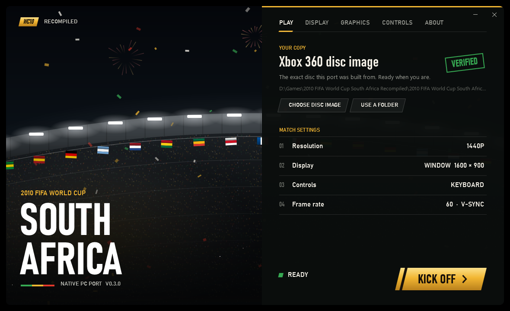

<div align="center">

# 2010 FIFA World Cup South Africa: Recompiled

<p>
  <a href="https://github.com/CalinGraphics/fifa-world-cup-2010-recompiled/releases/latest">
    
  </a>
</p>

<p>
  <a href="https://github.com/CalinGraphics/fifa-world-cup-2010-recompiled/releases"></a>
  <a href="https://github.com/CalinGraphics/fifa-world-cup-2010-recompiled/stargazers"></a>
  <a href="https://github.com/CalinGraphics/fifa-world-cup-2010-recompiled/releases/latest"></a>
  <a href="#requirements"></a>
</p>

An *unofficial* native PC port of the Xbox 360 game **2010 FIFA World Cup South Africa**.
The game's PowerPC code is statically recompiled into C++ with [ReXGlue](https://github.com/rexglue/rexglue-sdk)
and compiled for Windows, with a Direct3D 12 renderer. No emulator.

**You need your own copy of the game.** No game files are included in this repository or its releases.

</div>



## Highlights

| | |
|---|---|
| **Native PC port**, no emulator | **60 fps** in matches, or locked to 30 |
| Render at **720p, 1440p or 4K** | **Anisotropic filtering** up to 16x |
| Runs **straight from your disc image** (`.iso`), nothing to extract | **Controller** (Xbox, PlayStation, others) or **keyboard** |
| **Launcher** that checks your copy and holds every setting | **FPS counter** (F2), saves and logs in one folder, **portable** mode |

## Playing

1. Download the zip from [Releases](https://github.com/CalinGraphics/fifa-world-cup-2010-recompiled/releases/latest)
   and extract it anywhere, e.g. `C:\Games\WC2010` (not inside `Program Files`).
2. Run **`Launcher.exe`**.
   > The program isn't code-signed, so Windows may show "Windows protected your PC". Choose **More info**, then **Run anyway**.
3. Click **Choose disc image** and pick your Xbox 360 `.iso` (or drop it on the window).
   The launcher checks that it's the right version.
4. Press **KICK OFF**.

Quit with **Alt+F4**; the game saves automatically.

### The launcher

| Page | Settings |
|---|---|
| **Play** | Your game copy and its check, a summary of your settings |
| **Display** | Window, borderless or exclusive fullscreen; window size; V-Sync; frame rate (60 or 30); FPS counter |
| **Graphics** | Render resolution (720p / 1440p / 4K), texture filtering |
| **Controls** | Controller or keyboard, with the keyboard layout |
| **About** | Saves and logs folder, desktop shortcut, reset settings |

On first start it picks settings for your screen (your monitor's size, 1440p rendering, or 4K on a 4K display).

### Keyboard

| Action | Key | Action | Key |
|---|---|---|---|
| Move | `W` `A` `S` `D` | Pace control (LT) | `Q` |
| Short pass (A) | `Space` | Sprint (RT) | `E` |
| Shoot (B) | `Backspace` | Player run / finesse (LB / RB) | `1` / `3` |
| Lob / cross (X) | `L` | Skill moves (right stick) | Arrow keys |
| Through ball (Y) | `P` | D-pad | `Shift` + arrows |
| Pause / Back | `Enter` / `Tab` | FPS counter on / off | `F2` |

## Requirements

The game leans on the graphics card more than the processor. 4K rendering needs a mid-range card or better.

| Requirement | Details |
|---|---|
| Windows | 10 or 11, 64-bit |
| Graphics | Direct3D 12, with up-to-date drivers |
| Processor | x86-64 with SSE4.2 |
| The game | Your own *2010 FIFA World Cup South Africa* for **Xbox 360**, as a disc image (`.iso`) or a folder with `default.xex` |

### Which version you need

The port is built from one specific Xbox 360 disc: **Europe (En, Es, Nl)**. Other regions or versions won't run,
and the launcher tells you so. The PS3 version is recognised but not supported.

| File | SHA-256 |
|---|---|
| `default.xex` | `D0DF5465E077EAEBEADDA252C786D9322551AB13EF23AAD461836E510971337D` |
| `fifadllzf.xex` | `462676F9FBAB83530C2659E79AA43E3DBE81B43DC917DB9299933C19FA34905D` |

### Where things are

| Item | Location |
|---|---|
| Saves, settings, logs, shader cache | `%LOCALAPPDATA%\FIFA World Cup 2010 Recompiled` |
| Portable mode | Create an empty `portable.txt` next to `Launcher.exe`: everything goes to a `userdata` folder there instead |

## Known issues

- Menus and cutscenes run at 30 fps, as on the console; matches run at 60. The 30 fps option locks matches to 30 too.
- Online modes (Xbox Live) don't work.
- Not every game mode has been played through end to end yet. Reports are welcome.

## Troubleshooting

| Problem | Fix |
|---|---|
| "This copy is a different version" | You need the Europe Xbox 360 disc (En, Es, Nl); see the hashes above. |
| The game doesn't start | Update your graphics driver (Direct3D 12 is required). Check the latest log in the saves and logs folder. |
| Controller not detected | Connect it before pressing Kick off, and choose **Controller** on the Controls page. |
| Low frame rate | Lower the render resolution to 1440p or 720p on the Graphics page. |
| Laptop runs the game on the integrated GPU | Windows Settings → System → Display → Graphics: set `fifawc10.exe` to High performance. |

Problems go in the [Issues](https://github.com/CalinGraphics/fifa-world-cup-2010-recompiled/issues).
Attach the newest `logs\fifawc10_*.log` (About, **Saves and logs** opens the folder) and the launcher's version.

## Building from source

Building needs your own copy of the game too: the code generator reads its executables.
Put your `.iso` in the repository folder, then:

```powershell
powershell -ExecutionPolicy Bypass -File build.ps1 -Package
```

The first build gets and builds the ReXGlue SDK too (about an hour); later builds take minutes.
Requirements and details are in [BUILDING.md](BUILDING.md).

## Repository

| Path | What it is |
|---|---|
| [`build.ps1`](build.ps1) | The whole build: SDK, code generation, game, launcher, release zip |
| [`pc/`](pc/) | The Windows app (`src/`), hooks in the game module (`fixes/`), the codegen manifest and analysis overrides (`config/`) |
| [`launcher/`](launcher/) | The launcher (WPF, .NET 10): game check, settings, start |
| [`installer/`](installer/) | Release packaging and the player readme shipped in the zip |
| [`patches/rexglue-sdk/`](patches/rexglue-sdk/) | Changes to the ReXGlue SDK, applied on top of a fixed SDK commit |
| [`tools/`](tools/) | SDK setup, disc image reader, reverse-engineering helpers used while porting |
The C++ translated from the game (`pc/generated/`) isn't part of this repository. It's generated on your
own PC from your own copy of the game when you build.

## Credits

- Port by **Călin Miertescu** ([CalinGraphics](https://github.com/CalinGraphics)).
- Built on [ReXGlue](https://github.com/rexglue/rexglue-sdk), the recompiler and runtime.
- [Xenia](https://xenia.jp), whose Xbox 360 research, GPU and kernel code ReXGlue builds on.
- **EA Canada** and **Electronic Arts** for the game.

## License

This project's own code (launcher, app, hooks, SDK patches, tools) is under the [BSD 3-Clause license](LICENSE).
It doesn't cover the game, its content, or the code recompiled from it. Third-party components in the
releases (the ReXGlue SDK, which builds on Xenia, FFmpeg, SDL and others) keep their own licenses, shipped
in the `licenses` folder of every release.

## Legal

Unofficial, non-profit fan project. Not affiliated with, endorsed or sponsored by Electronic Arts, EA Sports,
FIFA or Microsoft. *2010 FIFA World Cup South Africa*, its content and trademarks belong to their owners.
**Please don't open issues asking for game files.** If a rights holder raises a valid concern, it will be addressed.
